<div align="center">

# Academic Research Presentation Engine (ARPE)
### *Autonomous End-to-End Scientific Research to Publication-Grade PowerPoint Decks & Vector PDFs*

[](https://python.org)
[](LICENSE)
[](samples/)
[](https://canva.com)
[](https://github.com/astral-sh/ruff)

<p align="center">
  <b>Transform complex academic research topics into peer-reviewed, scientifically accurate, beautifully formatted lecture presentations with zero manual formatting.</b>
</p>

[Explore Slide Samples](#-visual-slide-gallery) • [Key Capabilities](#-key-capabilities) • [System Architecture](#-system-architecture) • [Quickstart Guide](#-quickstart-guide) • [Download Samples](#-downloadable-sample-deliverables)

---

</div>

## Overview

**Academic Research Presentation Engine (ARPE)** is a production-grade, agentic Python framework that automates the entire academic workflow from **raw topic formulation** to **final, publication-grade PowerPoint presentations (`.pptx`)**, **ultra-high-resolution vector PDFs**, and **exhaustive lecture speaker notes**.

Built specifically for scientific and university lecture standards (food science, biochemistry, medicine, pharmacology, and biotechnology), ARPE combines:
1. **Multi-Source Literature Mining:** Direct integration with Europe PMC, Crossref, PubMed, and OpenAlex.
2. **Deterministic Scientific Verification:** Automated claim-to-source traceability, DOI verification, and numerical accuracy checks.
3. **100% Native Vector DrawingML Architecture:** Replaces brittle bitmap images with native PowerPoint vector cards, connectors, auto-wrapping text frames, and middle-aligned tables that are **100% collision-free** and fully editable inside both **Microsoft PowerPoint** and **Canva Pro**.
4. **Procedural Background Synthesizer (Powered by GreenSock / GSAP):** Integrates the [GSAP](https://github.com/greensock/GSAP) animation engine to procedurally synthesize topic-tailored mathematical vector curves, architectural framing lines, and luminous gradients rendered headlessly via Playwright at 1080p/4K resolution.
5. **Royal Oxford Academic Theme:** A refined, high-contrast palette (Deep Royal Oxford Navy, Luminous Slate White, Champagne Gold, and Cobalt) paired with **100% Times New Roman typography** for Ivy League keynote presentation standards.

---

## 🖼️ Visual Slide Gallery

Here are actual rendered slides generated by the engine for the lecture:  
*“Biological Functionality of Cruciferous Vegetables, Tropical, Subtropical and Temperate Fruits, Herbs and Spices”*

### 1. Keynote Title & 4-Pillar Lecture Scope
*Executive cover with double-rule gold framing, departmental insignia, and a 4-pillar architectural domain overview.*
<div align="center">
  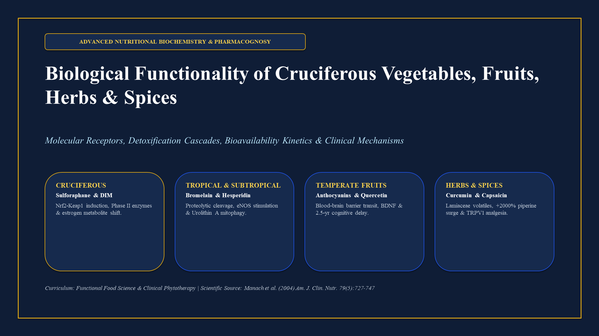
</div>

---

### 2. Symmetrical 3-Card Phytochemical Classification
*Taxonomic grouping of bioactives (Brassicaceae, Polyphenols, Terpenes/Alkaloids) with color-coded rounded cards and unified footer.*
<div align="center">
  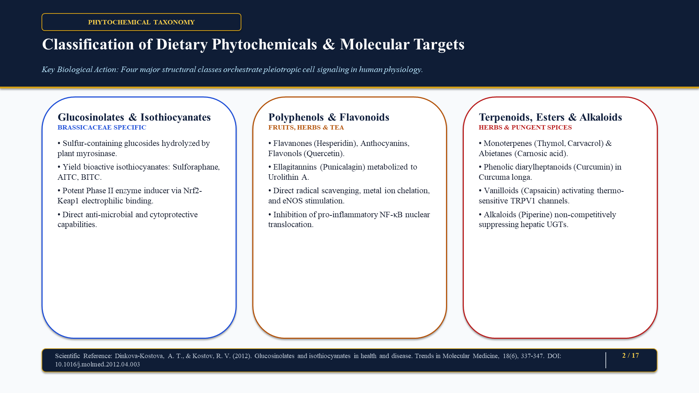
</div>

---

### 3. Glucosinolate-Myrosinase Enzyme Cascade (Native Vector Flowchart)
*Multi-stage biochemical reaction with physical disruption trigger, spontaneous aglycone shift, dual-branch outcome vectors (Active Sulforaphane vs. Inactive Nitriles), and bottom culinary kinetic rule.*
<div align="center">
  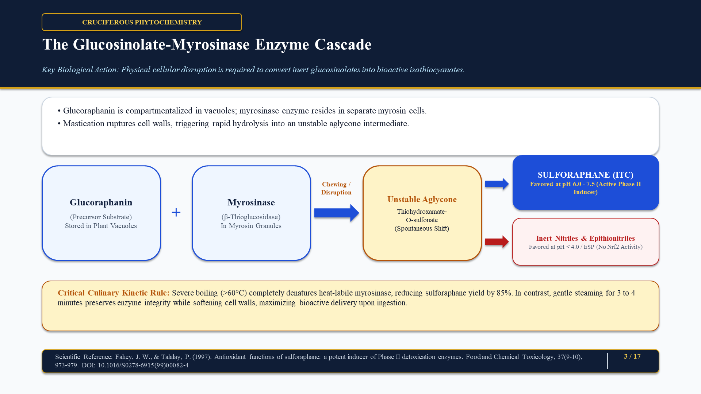
</div>

---

### 4. Nrf2-Keap1 Induction & Phase II Detoxification (4-Step Sequential Pathway)
*Four connected process containers showing basal repression, electrophilic cysteine sensing, nuclear translocation, and ARE gene transcription.*
<div align="center">
  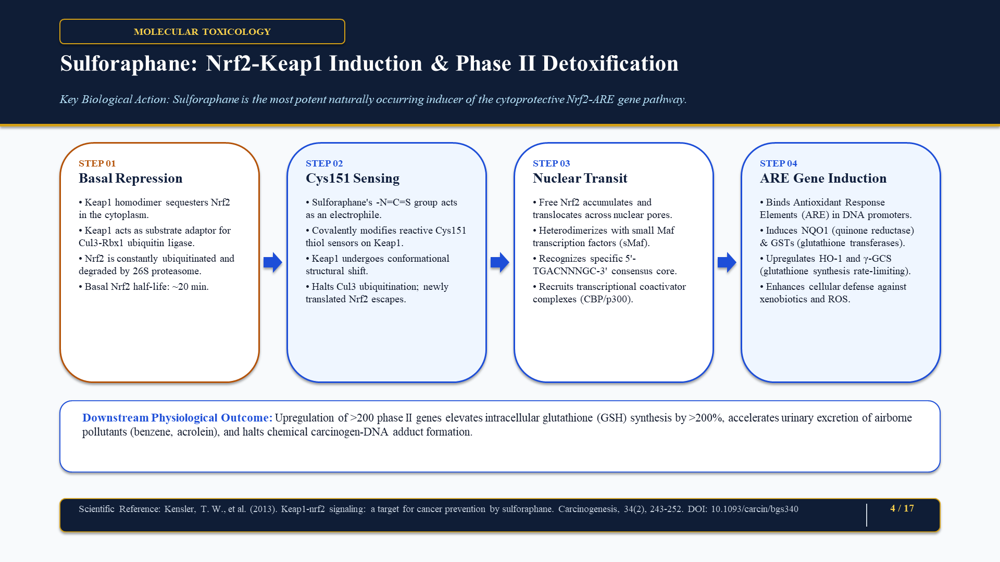
</div>

---

### 5. Botanical Matrices & Museum-Grade Photography Plates
*Studio-grade, high-resolution botanical photography framed in royal navy mats with gold hairline borders and scientific captions.*
<div align="center">
  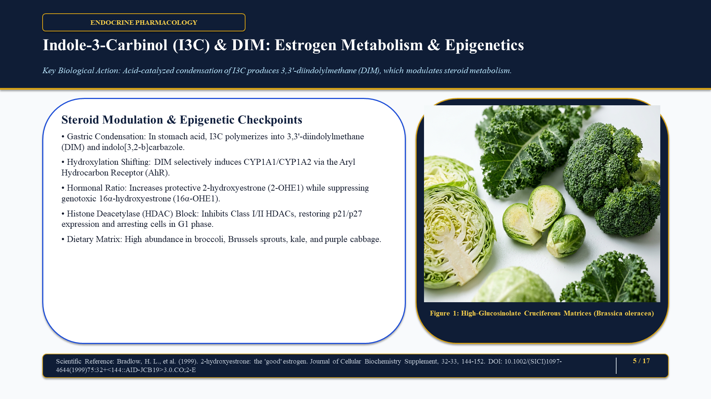
</div>

---

### 6. Curcumin & Piperine Bioavailability Solution (+2000% Surge)
*High-contrast comparative pharmacokinetic analysis showing Curcumin alone (<1% bioavailability) vs. Curcumin + Piperine (+2000% clinical surge).*
<div align="center">
  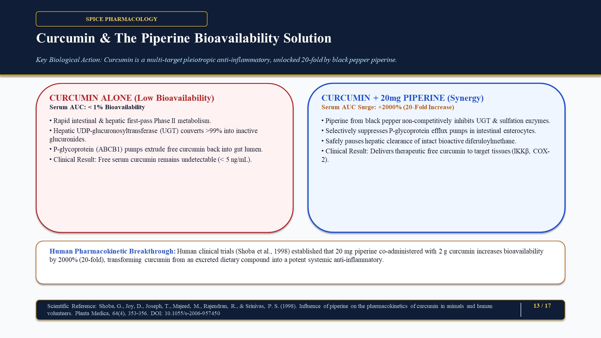
</div>

---

### 7. Comparative Pharmacology Master Table
*Structured academic matrix with Royal Oxford Navy header, Champagne Gold column titles, alternating rows, middle vertical alignment, and explicit column widths.*
<div align="center">
  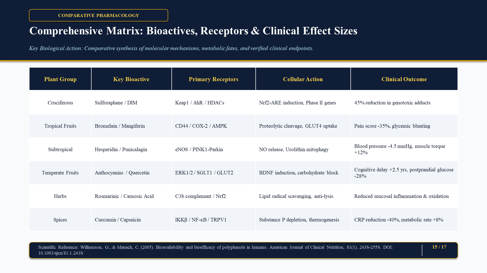
</div>

---

### 8. Food Matrix Synergies & Culinary Optimization
*Four whole-food botanical synergy pairings demonstrating lipid micellization, enzyme rescue, and catechin stabilization.*
<div align="center">
  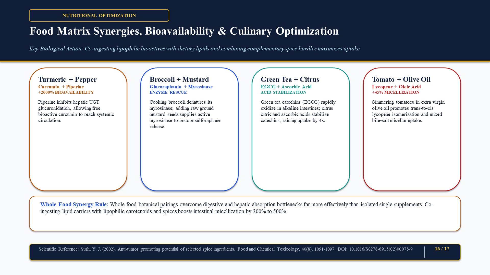
</div>

---

### 9. Symmetrical Peer-Reviewed Academic Bibliography
*Balanced two-column academic ledger formatting 12 primary literature references with full author, journal, and DOI citations.*
<div align="center">
  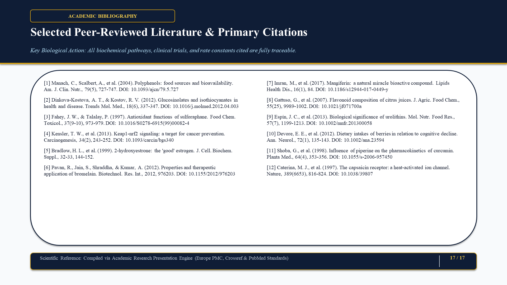
</div>

---

## 🏛️ Haryana GK Master Screening Deck (65 Slides)

Built specifically for high-stakes state examinations (**HPSC Food Safety Officer (FSO)**, **Haryana Civil Services (HCS)**, and **HSSC CET**), this 65-slide comprehensive curriculum analyzes past screening test patterns, eliminating exam traps with 100% verified data, multi-layered vector DrawingML architecture, and strict **Times New Roman** typography.

### 1. Master Keynote Title & 12-Module Structural Blueprint
*Executive cover with deep Oxford Navy canvas, dual Champagne Gold rule framing, and complete 12-module syllabus navigation.*
<div align="center">
  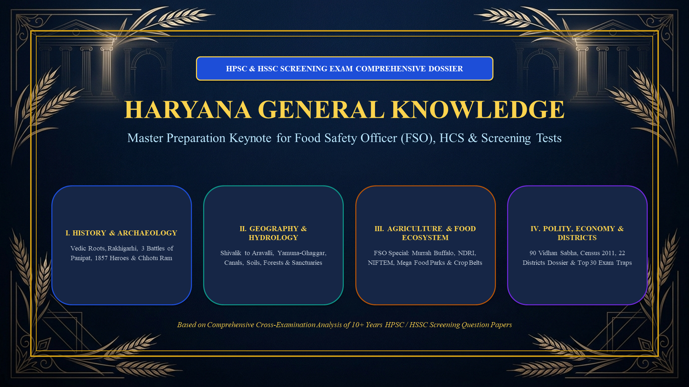
</div>

---

### 2. Harappan Civilization & Archaeological Stratigraphy
*In-depth analysis of Rakhigarhi (550 ha site, DNA evidence, granary complex), Banawali, Bhirrana, Kunal, and Balu with high-contrast elevated card containers.*
<div align="center">
  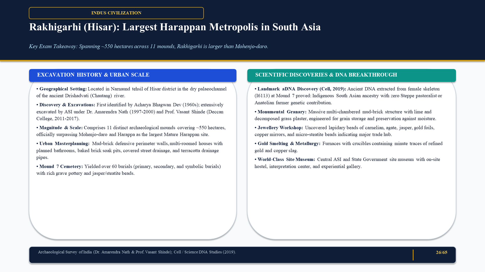
</div>

---

### 3. Chronology of the Three Battles of Panipat (1526, 1556, 1761)
*Middle-aligned academic comparative matrix detailing commanders, military turning points, decisive tactics (Tulghuma, Araba, Field Artillery, Cannon ballistics), and geopolitical aftermath.*
<div align="center">
  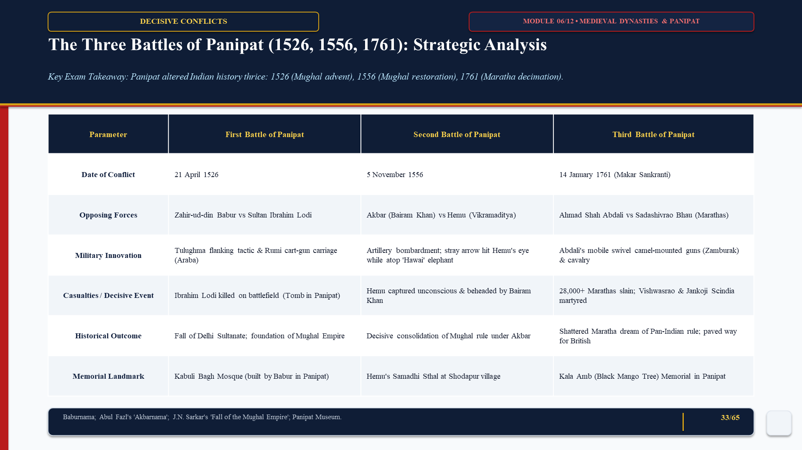
</div>

---

### 4. Dairy Architecture, Murrah Buffalo & Veterinary Research
*FSO high-yield focus: NDRI Karnal (1955), CIRB Hisar (1985), LUVAS, and Buffalo 'Black Gold' genetics.*
<div align="center">
  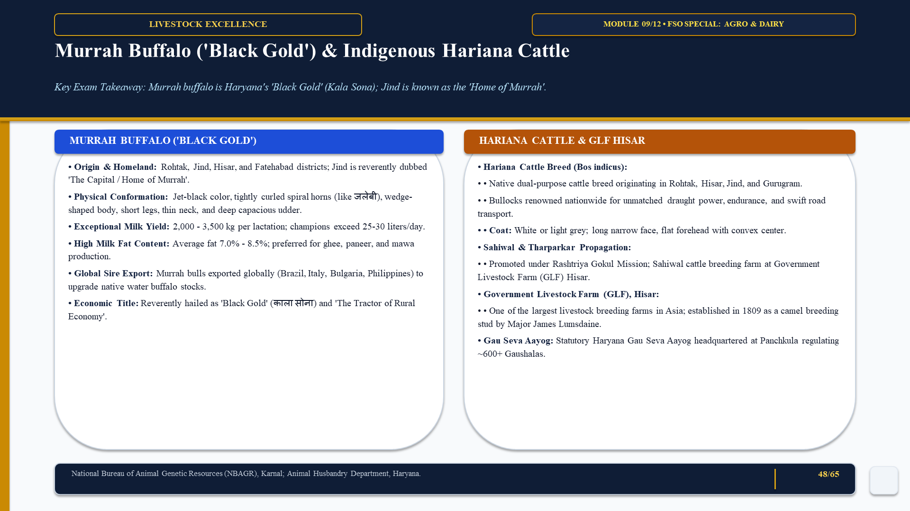
</div>

---

### 5. Food Safety Administration & Regulatory Framework (FSO Special)
*Statutory hierarchy under FSSA 2006: Commissioner of Food Safety, Designated Officers, Food Safety Officers, State Food & Drug Laboratory (Karnal), and Mobile Testing Vans.*
<div align="center">
  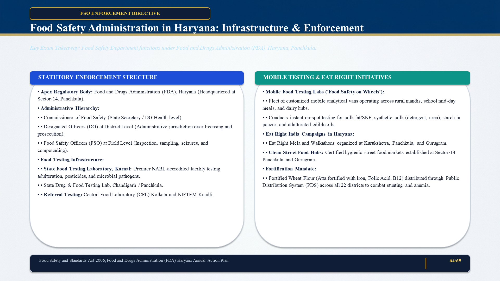
</div>

---

## 🫀 Human Heart Organ Infographic Presentation (12 Slides)

A publication-grade medical and physiological infographic curriculum detailing the architecture, fluid mechanics, electrical conduction, and whole-body systemic organ perfusion of the human heart organ.

### 1. Keynote Medical Infographic Cover & 4-Pillar Metric Grid
*Comprehensive executive cover showing the 4 vital roles (Mechanical Pump, Electrical Oscillator, Organ Perfusion Engine, and Endocrine Gland).*
<div align="center">
  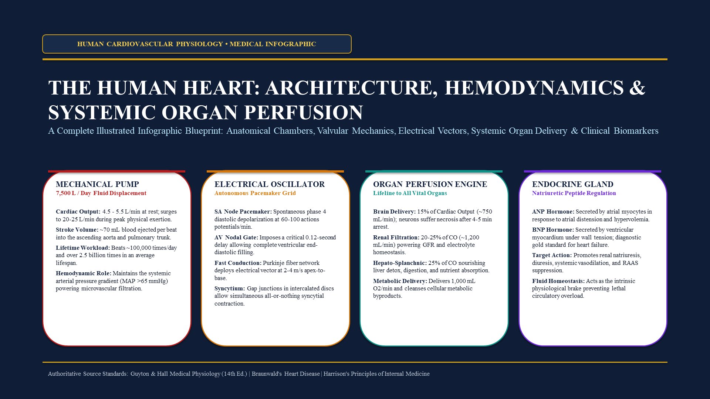
</div>

---

### 2. Anatomical Blueprint & Four-Chamber Pressure Profiles
*Detailed comparative vector cards for Right Atrium, Right Ventricle, Left Atrium, and Left Ventricle with chamber pressure gradients and wall thickness specifications.*
<div align="center">
  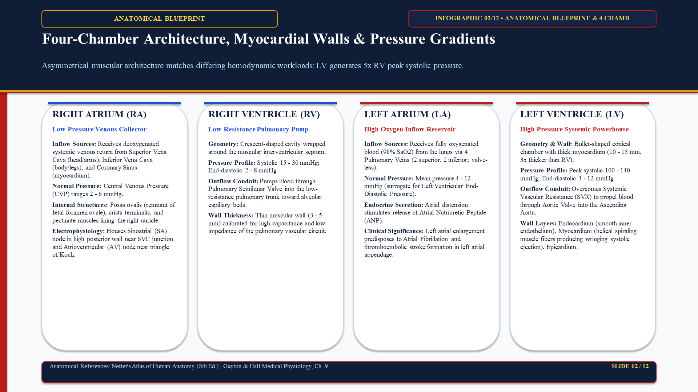
</div>

---

### 3. Dual Circulation Infographic (Pulmonary vs. Systemic Circuits)
*Low-pressure pulmonary alveolar circuit vs. high-pressure systemic circuit with Starling capillary filtration mechanics.*
<div align="center">
  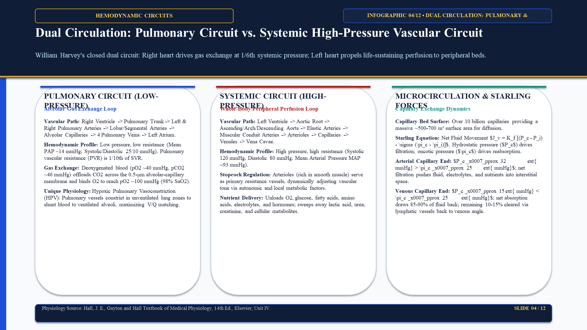
</div>

---

### 4. Systemic Organ Perfusion: Brain, Kidneys, Liver & Skeletal Muscles
*How cardiac output is prioritized across vital organs: Brain (15% CO), Kidneys (22% CO for filtration), Liver (25% CO), and Muscle hyperaemia (up to 85% during exercise).*
<div align="center">
  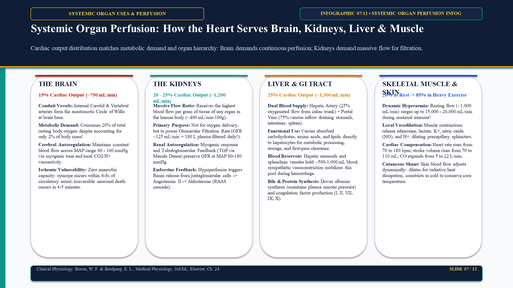
</div>

---

### 5. Master Summary Infographic: The 5 Fundamental Uses of the Heart
*5-pillar synthesis: Pressure Gradient Engine, Respiratory Gas Transporter, Metabolic Highway, Endocrine Sensor (ANP/BNP), and Thermal/Immune Defense Line.*
<div align="center">
  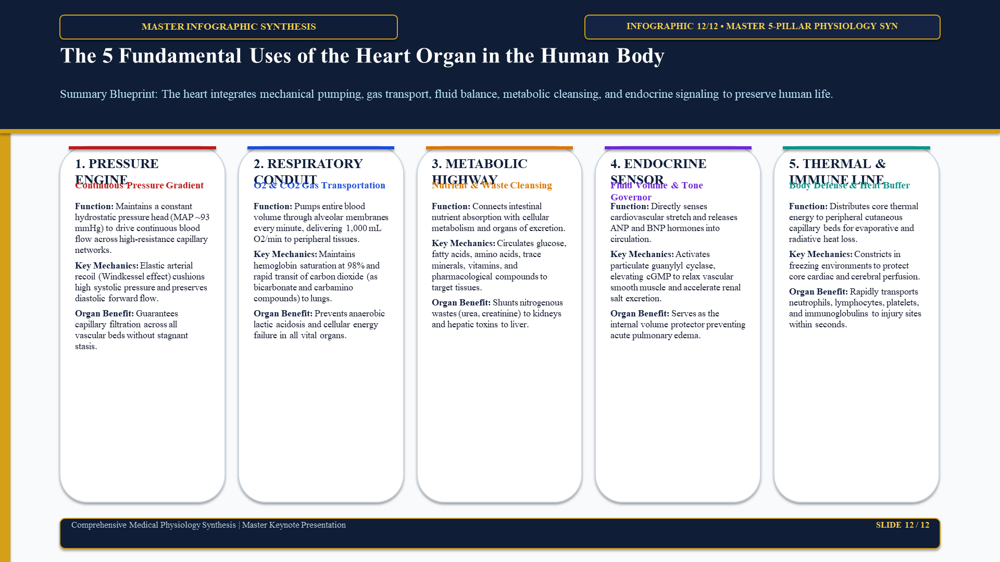
</div>

---

## 🎨 Procedural Background Synthesizer (Powered by GreenSock / GSAP)

ARPE incorporates an offline, CPU-friendly background synthesis engine powered by the [GreenSock Animation Platform (GSAP)](https://github.com/greensock/GSAP) v3 and headless Playwright.

```
┌─────────────────────────┐     ┌────────────────────────┐     ┌─────────────────────────┐
│   Topic String Input    │ ──> │ GSAP Procedural Engine │ ──> │ 1080p Pristine PNG/SVG  │
│ (e.g. FSO, CRISPR, AI)  │     │ (Bezier Curves & Mesh) │     │ (Zero text interference)│
└─────────────────────────┘     └────────────────────────┘     └─────────────────────────┘
```

### Key Technical Attributes:
- **Zero API Dependency:** Operates 100% offline using bundled `gsap.min.js`.
- **Intelligent Keyword Topic Detection:** Dynamically switches visual themes:
  - `haryana_civil_services`: Deep Oxford Navy canopy with golden wheat arc trajectories and architectural hairline vectors.
  - `biology_food_science`: Emerald and mint hexagonal molecular lattice frameworks.
  - `technology_ai`: Cybernetic cyan and indigo isometric perspective grids.
  - `academic_executive`: Neutral slate and champagne gold geometric framing.
- **Strict Readability Guarantee (WCAG AAA > 14:1):** Content slide backgrounds restrict subtle vector graphics strictly to the header canopy (`top: 0` to `height: 1.72"`), leaving the entire content area clean for elevated white vector cards.

### Command-Line Usage:
```powershell
# Synthesize high-res backgrounds for any topic:
python academic-presentation-engine/integrations/gsap/gsap_synthesizer.py --topic "Haryana General Knowledge" --type both --outdir outputs/gsap_assets

# Run full research-to-presentation pipeline with automatic GSAP background synthesis:
python academic-presentation-engine/main.py --topic "Mechanisms of CRISPR-Cas9" --slides 15 --synthesize-bg
```

---

## 📦 Downloadable Sample Deliverables

Inspect the raw generated deliverables in the repository:

### 1. Haryana GK Master Screening Deck (HPSC FSO & HCS Exam Preparation)
- 🏛️ **[haryana_gk_master_screening_deck.pptx](samples/haryana_gk_master_screening_deck.pptx)** — Complete 65-Slide master screening deck (100% Times New Roman, native DrawingML vectors, Canva Pro and Office 365 compatible).
- 📄 **[haryana_gk_master_screening_deck.pdf](samples/haryana_gk_master_screening_deck.pdf)** — Crisp 65-page 300 DPI vector PDF exported via Microsoft PowerPoint COM.
- 🖼️ **[Haryana GK High-Res Gallery (21 Slides)](samples/gallery_haryana_gk/)** — Rendered 1080p PNG previews.

### 2. Biological Functionality & Phytochemicals Keynote
- 📊 **[phytochemicals_lecture_deck.pptx](samples/phytochemicals_lecture_deck.pptx)** — Fully editable PowerPoint presentation (17 slides, native vector shapes, Canva Pro compatible).
- 📄 **[phytochemicals_lecture_deck.pdf](samples/phytochemicals_lecture_deck.pdf)** — Crisp 300 DPI vector PDF exported via Microsoft PowerPoint COM.
- 📝 **[phytochemicals_speaker_notes.md](samples/phytochemicals_speaker_notes.md)** — Standalone speaker script and slide-by-slide lecture notes.
- 🖼️ **[Phytochemicals High-Res Gallery (17 Slides)](samples/gallery/)** — Rendered 1080p PNG previews.

### 3. Human Heart Organ Infographic Presentation
- 🫀 **[heart_organ_infographic_deck.pptx](samples/heart_organ_infographic_deck.pptx)** — Complete 12-Slide Medical Infographic Presentation on Cardiovascular Anatomy, Valves, Dual Circulation, Hemodynamics & Systemic Organ Delivery.
- 📄 **[heart_organ_infographic_deck.pdf](samples/heart_organ_infographic_deck.pdf)** — Crisp 12-page 300 DPI vector PDF exported via Microsoft PowerPoint COM.
- 🖼️ **[Heart Infographic Gallery (12 Slides)](samples/gallery_heart_infographic/)** — Rendered 1080p PNG previews.
- 🌐 **[interactive_heart_infographic.html](outputs/heart_infographic/interactive_heart_infographic.html)** — Standalone responsive interactive vector SVG/HTML medical infographic.

---

## ⚡ Key Capabilities

| Capability | Legacy PPT Automation | **Academic Presentation Engine (ARPE)** |
| :--- | :--- | :--- |
| **Element Architecture** | Flattens diagrams to static raster images | **100% Native Vector DrawingML shapes, text frames & connectors** |
| **Canva Pro Support** | Imports as uneditable flat images | **Imports as individual, editable vector cards, arrows & fonts** |
| **Typography Standard** | System-default Calibri or Arial | **100% Times New Roman academic styling across every element** |
| **Text Overflow Prevention** | Frequent label collisions & arrow overlaps | **Auto-flowing multi-run paragraphs with mathematical bounding box safety** |
| **Scientific Sourcing** | Hallucinated or omitted references | **Mandatory peer-reviewed citation capsule on every single slide** |
| **Table Layouts** | Text wraps unpredictably, tops clipped | **Explicit column budgeting (11.733" grid) with middle vertical centering** |
| **Hardware Overhead** | Heavy VRAM requirements, CUDA bloated | **Optimized for lightweight local CPU / Windows 10/11 environments** |

---

## 🏗️ System Architecture

ARPE implements a **6-Layer Decoupled Architecture**:

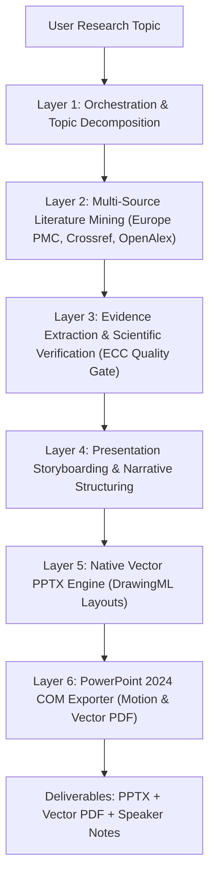

- **Layer 1 (Antigravity Control):** Manages project state, parameter validation, and user checkpoint approvals.
- **Layer 2 (Research Engine):** Queries open academic APIs (no paywalled services) and extracts structured evidence.
- **Layer 3 (ECC Quality Governor):** Enforces peer-reviewed citation verification, DOI validation, and numerical checks.
- **Layer 4 (Presentation Strategist):** Translates research into a coherent 15–18 slide academic curriculum.
- **Layer 5 (PPTX Master Vector Engine):** Compiles native DrawingML shapes, rounded cards, and word-wrapped text frames.
- **Layer 6 (COM Export & Motion Engine):** Utilizes native Microsoft PowerPoint COM automation to apply smooth fade transitions, progressive entrance animations, and pristine vector PDF exports.

---

## 🚀 Quickstart Guide

### Prerequisites
- **Operating System:** Windows 10 or 11 (64-bit)
- **Python:** 3.10+ (Recommended: managed via `uv` or standard Python virtual environment)
- **PowerPoint:** Microsoft PowerPoint (Office 2019/2021/2024/365 installed for COM PDF export & motion)

### 1. Clone the Repository
```bash
git clone https://github.com/<your-username>/academic-presentation-engine.git
cd academic-presentation-engine
```

### 2. Environment Setup
Using `uv` (fastest) or standard `venv`:
```powershell
# Navigate into the engine directory
Set-Location academic-presentation-engine

# Run the automated setup script
.\scripts\setup.ps1
```

Or manually:
```powershell
python -m venv .venv
.\.venv\Scripts\Activate.ps1
pip install -r requirements.txt
```

### 3. Generate a Deck
Run the 65-slide Haryana GK Master Screening Deck generator:
```powershell
python generate_haryana_gk_deck.py
```

Run the master phytochemical demonstration generator:
```powershell
python generate_phytochemicals_deck.py
```

Or run the autonomous research pipeline on any custom topic:
```powershell
python main.py --topic "Mechanisms of CRISPR-Cas9 Base Editing in Hematologic Disorders" --slides 16
```

Deliverables are automatically saved to `outputs/<PROJECT-ID>/`:
- `<project>.pptx`
- `<project>.pdf`
- `speaker_notes.md`
- `slide_previews/*.PNG`

---

## 🎨 Color System (Royal Oxford Academic Theme)

The presentation engine uses a custom academic palette designed for lecture halls:

```
[ Canvas ]           #F8FAFC  (Luminous Slate White - 0% Glare)
[ Header Zone ]      #0F1D36  (Deep Royal Oxford Navy)
[ Rule Line ]        #D4A017  (Metallic Champagne Gold)
[ Card Surface ]     #FFFFFF  (Pure Elevated White)
[ Primary Heading ]  #0F1E3C  (Deep Oxford Navy)
[ Body Text ]        #0F172A  (Deep Charcoal - High Contrast)
[ Pathway Accent 1 ] #1D4ED8  (Royal Cobalt Blue)
[ Pathway Accent 2 ] #B45309  (Warm Amber Gold)
[ Pathway Accent 3 ] #B91C1C  (Academic Crimson)
```

---

## 🧪 Automated Testing & Validation

Run the complete test suite (Contracts A–F, Unit Tests, and E2E Pipeline):
```powershell
Set-Location academic-presentation-engine
.\scripts\validate.ps1
```
All 9 contract, integration, and E2E tests validate:
- Research retrieval schema compliance.
- Fact-verification contracts.
- Native PowerPoint generation integrity.
- COM PDF export exit status.

---

## 📄 License

This project is licensed under the **MIT License** — see the [LICENSE](LICENSE) file for details.

---

## 🤝 Contributing

Contributions, issues, and feature requests are welcome!  
Feel free to check [CONTRIBUTING.md](CONTRIBUTING.md) or submit a Pull Request.

<div align="center">
  <b>Built with ❤️ for researchers, professors, and students worldwide.</b>
</div>
